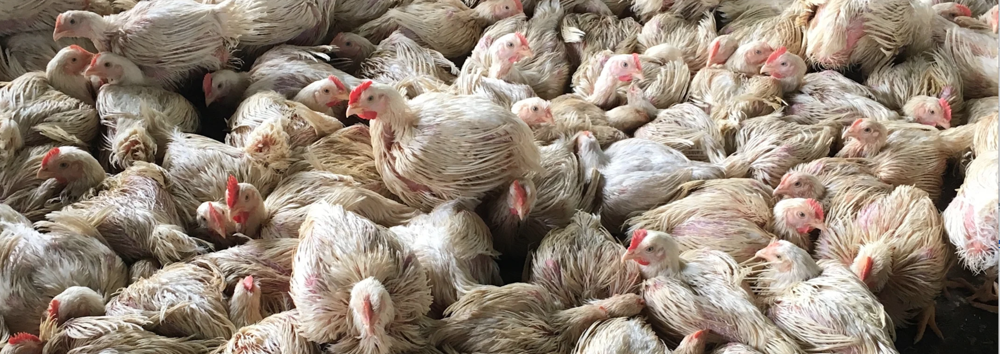
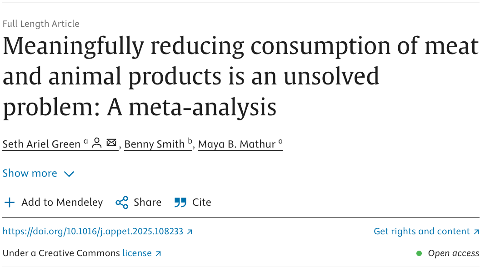
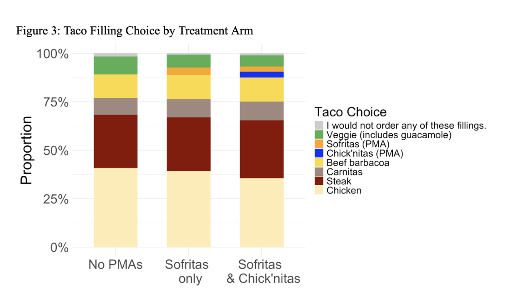
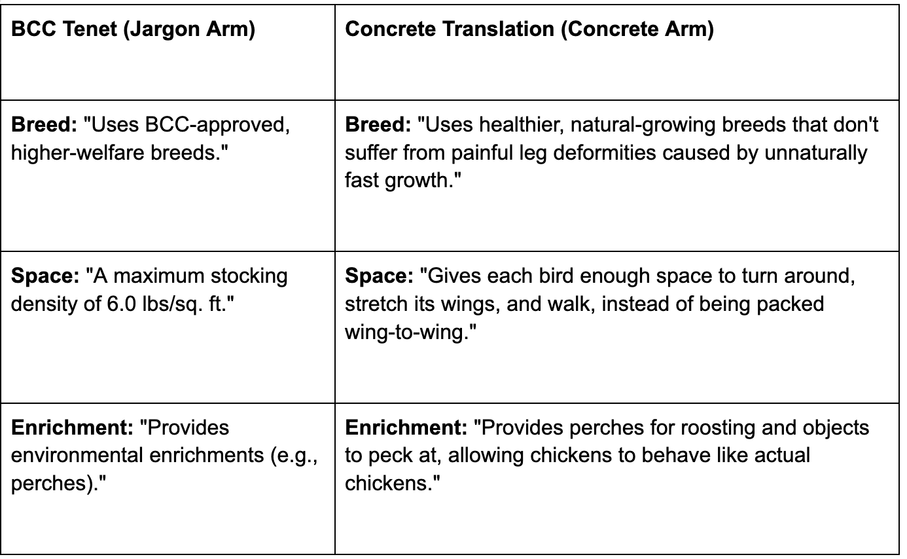

```{r setup, include=FALSE}
# Copy required files from package to working directory
pkg_resources <- system.file("rmarkdown/templates/foodlab_presentation", 
                             package = "foodlabslides")

# Copy theme file
theme_file <- file.path(pkg_resources, "resources/beamerthemeFoodLab.sty")
if (file.exists(theme_file)) {
  file.copy(theme_file, "beamerthemeFoodLab.sty", overwrite = TRUE)
}

# Copy preamble if not already present
preamble_file <- file.path(pkg_resources, "skeleton/preamble.tex")
if (file.exists(preamble_file) && !file.exists("preamble.tex")) {
  file.copy(preamble_file, "preamble.tex", overwrite = FALSE)
}

# Copy logo file
logo_file <- file.path(pkg_resources, "skeleton/foodlab-logo.png")
if (file.exists(logo_file)) {
  file.copy(logo_file, "foodlab-logo.png", overwrite = TRUE)
}

knitr::opts_chunk$set(echo = FALSE)
```

## Hi I'm Seth

-   I work at the Humane and Sustainable Food Lab (HSFL), which is dedicated to accelerating the end of factory farming.
-   I write stuff at <https://regressiontothemeat.substack.com/>.
-   I presented at RECAP previously about a meta-analysis (more on that in a minute).

## Small body problem

-   Also called the small animal replacement problem.
-   Defined on the [EA forum](https://forum.effectivealtruism.org/topics/small-animal-replacement-problem) as "is the concern that certain diet changes aimed at causing less harm to the world might, in fact, cause more harm - specifically, changes that result from eating smaller animals instead of larger ones"
-   It's a problem because it puts the climate movement and the animal activism movement at cross-purposes, e.g. the [coolfood pledge from WRI](https://coolfood.org/) which encourages people to eat more chicken and fish.
-   There's a fair bit of philosophical/ethical work about SBP — Maya has [written about this](https://www.science.org/doi/10.1126/science.abo2535) — but [almost nothing](https://www.arxiv.org/abs/2503.04734) empirical addressing the small body problem directly.

## Chickens are numerous and their lives are bad

-   Almost all terrestrial farmed animals are chickens – about 70 of 80 billion or so.

-   Their lives are especially bad, per [Will McAskill](https://ora.ox.ac.uk/objects/uuid:23a1d45a-50a8-4550-bc61-a08205dc6622/files/mf81bad5c1e62b49db0083cfa8e18d353) (& others): "Of all the animals raised for food, **broiler chickens, layer hens, and pigs are kept in the worst conditions**, by a considerable margin...[On a scale of -10 to 10, economist Bailey] Norwood rates beef cattle at 6 and dairy cows at 4. In contrast, his average rating for broiler chickens is -1, and for pigs and caged hens is -5."

## It's hard to empathize with chickens

We (advocates and vegans) are weird. We look at [pictures like this one from The Humane League](https://thehumaneleague.org/article/how-many-chickens-are-in-the-world) and say, that's horrible! Most people don't feel the same way. [Evolutionary distance](https://www.nature.com/articles/s41598-019-56006-9) matters.

{width="400"}

## Context: meaningfully reducing consumption of meat and animal products is hard

::::: columns
::: column
-   Last year I worked on a [meta-analytic review](https://doi.org/10.1016/j.appet.2025.108233) of interventions to get people to eat less MAP.

-   As of 12/2023, 35 papers met our criteria (RCTs with \> 50 subjects that measured MAP consumption directly at least a day after treatment began), and none focused on chickens specifically.

-   No approach consistently produces meaningful effects, all effect sizes small.
:::

::: column
{width="110%"}
:::
:::::

## Chicken analogues on menus?

-   My colleague Jessica is going to talk more about this at a future meeting, but spoiler, in a Chipotle-like setting, adding new plant-based options [doesn't seem to do much](https://regressiontothemeat.substack.com/), including a chicken analogue.

    {width="300"}

## So how are we going to build empathy for chickens?

-   I have five ideas, but they're not very good (either not going to be persuasive or not an interesting question).

-   I'll briefly describe them, and then I want you to tell me how they can be better :)

## But first, what makes a good paper?

-   Starts with a good question! That's where I'm stuck.

    -   I think I have a research *topic* — chickens — but not a research question (CC Kristin Luker's [*Salsa Dancing Into the Social Sciences*)](https://www.jstor.org/stable/j.ctv1kmj7x0).

    -   I can narrow it even further to Angrist & Pischke's first FAQ in [*Mostly Harmless Econometrics*](https://www.dsecoaching.com/pdf/2008%20Angrist%20Pischke%20MostlyHarmlessEconometrics.pdf) – "What is the causal relationship of interest?"

        -   I don't know what my Y is. I think once we pin that down it won't be too hard to figure out the X. But when it comes to chickens, what's the right [estimand](https://regressiontothemeat.substack.com/p/the-hard-part-is-defining-your-estimand)?

## Idea 1: Start by talking about animal weights as a way of thinking about SBP

Something like:

-   "How big do you think a cow is? How big do you think a chicken is?"

-   "Actually the answers are 6 pounds and 1200 pounds. So it takes about 200 times more chickens to produce a given amount of meat as it does cows...this called the small body problem"

-   "How does that make you feel about eating these animals? Are chicken's numerous deaths morally relevant to your dietary choices?"

-   Problem: as a friend put it, "I think both of those animals are in the food chain so it doesn't matter how many of them have to die to feed me"

-   I think this will not meaningfully change how anyone eats.

## Idea 2: Explicitly frame the cow/chicken trade-off in trolley problem terms

Ask people:

-   "Say you could save the life of a cow or a chicken, but only one. Which would you choose?"

-   Then keep pushing forward until you got to a cow-chicken trade off number (e.g. 6 chickens is worth one cow)

-   "ACTUALLY COWS ARE HUGE SO DID YOU KNOW THE REAL RATIO IS LIKE 200 TO 1???"

Same problem as before: the number could be 1000 to 1 and it's still OK to eat both. (Also the "global warming is bad" term in the utility function might have a lot more weight than the animal welfare term.)

## Idea three: op-ed about the small body problem

::::: columns
::: column
-   Maya has a *Science* article about the small body problem, and we could write an op-ed or pamphlet adapting it.
-   I expect small effects. As a poli sci professor friend put it: "I am certain that attitudes are (a little bit) malleable on this subject, and I bet that an op-ed based on the Mathur Science you linked to would move attitudes, oh, by about 0.15 to 0.20 standard deviations in the short term :)"
:::

::: column
{width="250"}
:::
:::::

## Idea 4: get ethical vegetarians to really think about the egg/beef tradeoff

-   Ethical vegetarians draw the line at meat, but not eggs, for some set of reasons that boil down to "it feels bad to kill an animal to feed me."

-   But actually lots of chickens die in the egg-laying lifecycle, e.g. all the male chicks culled, and inevitably egg-laying hens are slaughtered when they stop laying and turned into dog food.

-   A beef cow lives about as long on average as an egg-laying hen and probably produces *more* burgers than an egg-laying hen produces eggs, depending on size and productivity. And again, beef cattle live better lives on average.

## Idea 4 continued

-   So all in all, you're contributing to just as many animal deaths, and a fair bit more animal suffering, when you buy eggs relative to beef. So why do you do it?

-   Goal of the study would be to put people on the spot where they really look inwards and answer this question.

Problem(s): I have no idea how to do this without provoking reactive defenses and I don't see a viable path from this to meaningful behavioral change.

I really do want to know what happens when you confront people with hard moral truths, but I don't see how that helps animals. Could be interesting anyway.

## Idea 5: test variants of the BCC for building popular support

::::: columns
::: {.column width="35%"}
-   Better [European] Chicken Commitment is actually pretty jargon-y b/c it's aimed at producers.
-   But if you wanted to test building popular support, you might try jargon-free language, like so, and see how that that affected support for a hypothetical policy making it mandatory
:::

::: {.column width="65%"}
{width="350"}
:::
:::::

## Idea 5 (problems)

-   This is my favorite I've come up with so far, and I think it would work to build that support, but it's not very *interesting.*
-   Of course framing things in terms people understand is going to increase support for a policy. But the BCC folks aren't *trying* to get popular support, they're trying to affect producer behavior.
    -   What's our theoretical quantity of interest here? Or am I just doing market research for animal advocacy orgs?
-   And what's our political lever here? ballots across Europe or California?

## That having been said

-   I like the idea of trying to build popular intuition around why fast-growing breeds are bad for chicken welfare.
-   A lot of the problems for chickens start there, but it's an abstract, unintuitive problem.
-   'Frankenchicken' is an effort to do this.
-   On the other hand,if that's all you change, it's not clear how that affects suffering overall. Could just be that you leave birds living marginally longer lives in hell.

## So...what should I do?

Some questions:

-   Did anything here strike you as likely to change attitudes?

-   If not, what would you suggest instead?

-   What's the right outcome?

-   Imagine a hypothetical budget of \$25K, how would *you* spend it to develop a novel idea about how to make people care about chickens?

-   Should I not be going for novel? Should I just be testing existing theories of making people care about chickens? If so what are the best theories?
